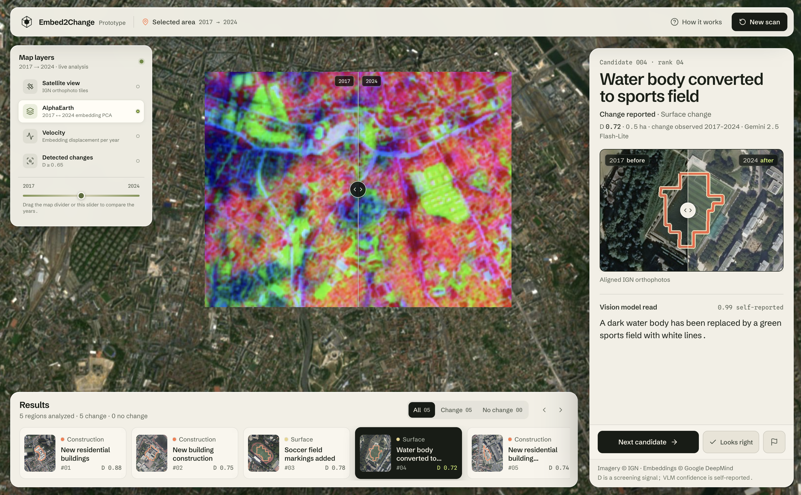

# Embed2Change Demo WebApp

This is a demo web application for the Embed2Change project. It showcases a complete pipeline from the user selecting a zone on the map to detected and interepreted changes in that zone. 



## Requirements

- Python 3.12
- Node.js 24
- A Google AI Studio API key (free tier works)

## Installation

### API Key
If you don't already have one, [create a Google AI Studio API key](https://aistudio.google.com/api-keys?hl=fr).
Create a .env file in the root directory of the project and add your API key:

```
GOOGLE_AI_STUDIO_API_KEY=your_api_key_here
```
see the `.env.example` file for reference.

### Frontend
1. Navigate to the `frontend` directory
2. `npm install`
   
### Backend
1. Navigate to the `backend` directory
2. Create a virtual environment: `python -m venv venv`
3. Activate the virtual environment:
   - On Windows: `venv\Scripts\activate`
   - On macOS/Linux: `source venv/bin/activate`
4. Install the required packages: `pip install -r requirements.txt`
   
## Usage

1. Start the backend server:
   - Navigate to the `backend` directory
   - Activate the virtual environment if not already activated
   - Run `python server.py`

2. Start the frontend server:
    - Navigate to the `frontend` directory
    - Run `npm run dev`

3. Open [http://localhost:5173](http://localhost:5173).
